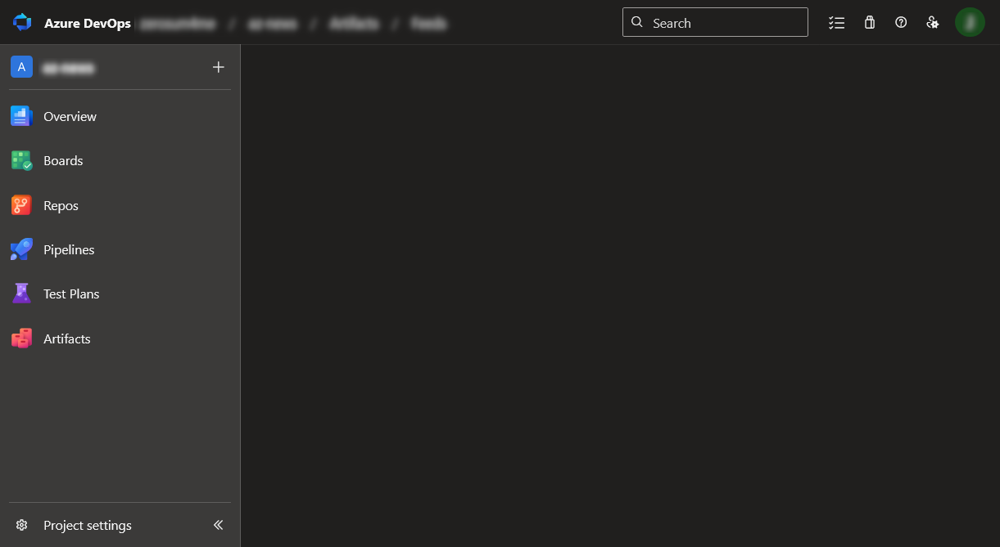
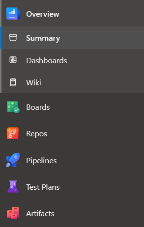
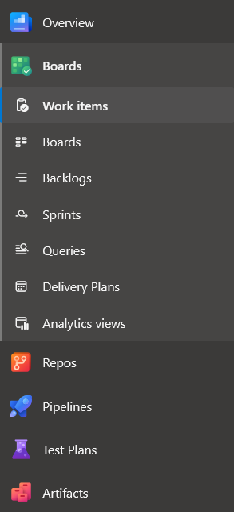
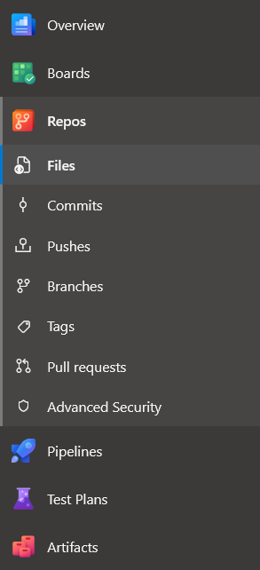
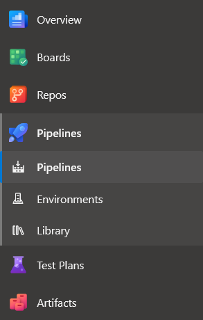
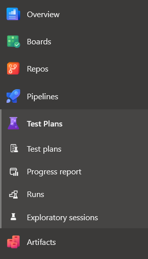
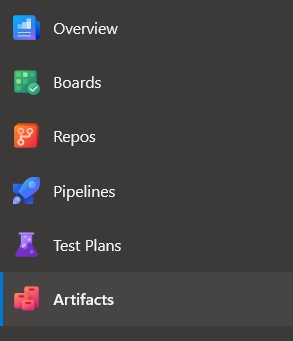
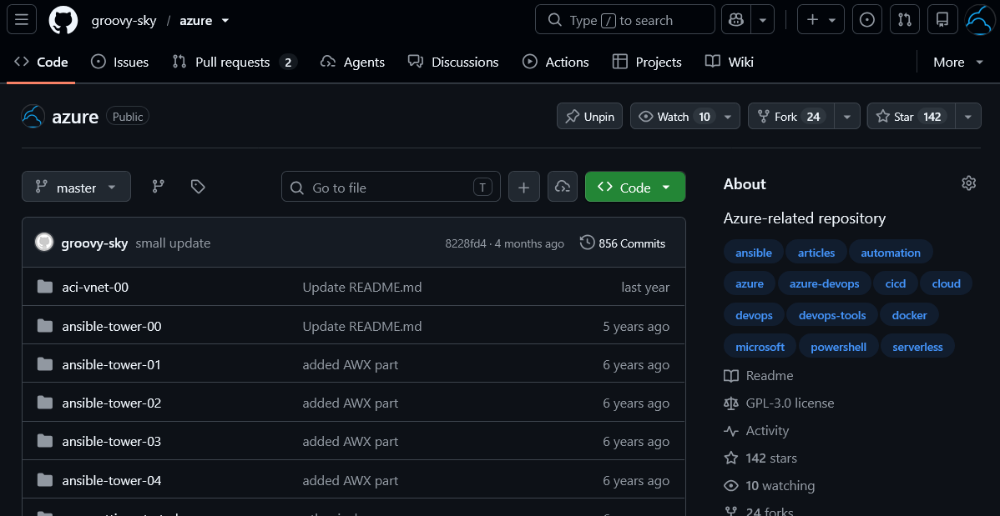

# Migrate from Azure DevOps to GitHub (part 1)

## Introduction

Moving from Azure DevOps to GitHub means changing how you manage code, tasks, and automation. Repos maps to GitHub repositories and pull requests, Boards to Issues and Projects, and Pipelines to Actions, but the features and configuration differ.

This first part explains CI/CD basics, the main sections of both platforms, and their terminology. It provides the background for migration, rather than step-by-step instructions for moving repositories or converting pipelines.

## Theory

### What is CI/CD?

**CI/CD automates building, testing, and releasing software.**

- **Continuous integration (CI):** Automatically build and test code changes.
- **Continuous delivery:** Keep tested software ready to release, possibly requiring approval.
- **Continuous deployment:** Automatically release changes that pass the required checks.

```text
Code change → Build → Test → Package → Deploy to testing
                                            ↓
                                      Approve → Production
```

### Azure DevOps structure

**Azure DevOps is a set of Microsoft tools for managing code, tasks, builds, and deployments.** Repos stores code, Boards manages tasks and bugs, and Pipelines automates building, testing, and deploying applications. 



The sidebar separates planning, code, automation, and testing:

| Section | Important pages |
|---|---|
| **Overview** | Summary, Dashboards, Wiki |
| **Boards** | Work items; Boards for workflow; Backlogs and Sprints for planning |
| **Repos** | Files, Branches, Commits, Pull requests |
| **Pipelines** | Pipelines for automation; Environments for deployment targets; Library for shared variables and secure files |
| **Test Plans** | Test cases, execution runs, and testing progress |
| **Artifacts** | Feeds containing reusable packages |

### Overview

Overview contains:
* **Summary** shows basic project information.
* **Dashboards** displays widgets such as work item counts and build results.
* **Wiki** stores documentation such as setup instructions and operating procedures.



### Boards

Boards contains:
* **Work items** record tasks, bugs, and user stories with owners, statuses, and discussions.
* **Boards** display work items by status.
* **Backlogs** prioritize upcoming work.
* **Sprints** organize tasks into time-limited iterations.
* **Links** connect work items to commits and pull requests.



### Repos

Repos contains:
* **Repositories** store source code; a project can contain multiple Git repositories.
* **Files** lets you browse source files.
* **Branches** keep changes separate before merging.
* **Commits** show the history of code changes.
* **Pull requests** support code review before merging.
* **Branch policies** can require approvals and successful build checks.



### Pipelines

Pipelines includes:
* **Pipelines** define build, test, and deployment steps in YAML or classic editors.
* **Triggers** start runs on code changes, schedules, or manual requests.
* **Agents** execute jobs.
* **Run logs** show each step's output.
* **Environments** represent deployment targets.
* **Library** stores shared variables and secure files.
* **Service connections** provide access to external systems.



### Test Plans

Test Plans includes:
* **Test plans** organize manual testing for a release or iteration.
* **Test suites** group related test cases.
* **Test cases** define steps and expected results.
* **Test runs** record outcomes and link failures to bugs.
* **Exploratory testing** supports testing without predefined steps.

Moving CI to GitHub Actions does not automatically transfer test cases or execution records.



### Artifacts

Artifacts includes:
* **Feeds** store and distribute packages for applications and pipelines.
* **Package formats** include NuGet, npm, Maven, Python, and Universal Packages.
* **Versions** let consumers select specific package releases.
* **Permissions** control who can publish and download packages.

When migrating, check package-format support and update package sources and authentication.




### GitHub structure

**GitHub is a platform for storing Git repositories and collaborating on code.** 

Microsoft owns both GitHub and Azure DevOps. In recent years, Microsoft has been investing heavily in GitHub and recommends GitHub for most new development projects, while Azure DevOps remains supported and used in enterprises.



GitHub structure is organized into several tabs, each serving a specific purpose for managing code, issues, projects, pull requests, workflows, security, and repository settings.

| Tab | Main purpose |
|---|---|
| **Code** | Browse files, branches, and commit history |
| **Issues** | Record bugs, features, and tasks |
| **Projects** | Organize issues and PRs using table, board, or roadmap views |
| **Pull requests** | Review proposed changes before merging |
| **Actions** | Run workflows and inspect execution logs |
| **Security and quality** | Inspect dependency, code, and secret findings |
| **Settings** | Configure access, merge requirements, and deployment controls |

**Wiki**, **Discussions**, and **Insights** support documentation, conversations, and activity reporting.

**Agents is not CI/CD execution:** it manages AI-assisted development sessions. Actions jobs execute on **runners**.

### Code

Code includes:
* **Files** lets you browse and edit source files.
* **Branches** keep changes separate before merging.
* **Commits** show the history of code changes.
* **Tags** mark specific versions of the code.
* **Releases** publish version notes and downloadable files.

### Issues and Projects

Issues and Projects include:
* **Issues** record bugs, tasks, and feature requests.
* **Assignees** identify who is responsible for an issue.
* **Labels** categorize work by type, priority, or area.
* **Milestones** group issues and pull requests toward a target.
* **Projects** organize work in table, board, and roadmap views.

### Pull requests

Pull requests include:
* **Changes** show differences between the source and target branches.
* **Reviews** let collaborators comment, approve, or request changes.
* **Checks** report automated build, test, and scanning results.
* **Merging** incorporates approved changes into the target branch.

Rulesets or branch protection can require reviews and successful checks before merging.

### Actions

Actions includes:
* **Workflows** define automation in YAML files under `.github/workflows/`.
* **Triggers** start runs on events, schedules, or manual requests.
* **Jobs and steps** organize commands and reusable actions.
* **Runners** execute jobs on GitHub-hosted or self-hosted machines.
* **Logs** show execution output for troubleshooting.
* **Artifacts** store files produced by workflow runs.
* **Environments** group deployment settings and available protection rules.

### Agents

Agents includes:
* **Sessions** organize AI-assisted coding work.
* **Tasks** describe changes for an agent to work on.
* **Proposed changes** need review and testing before merging.

Coding agents are separate from the runners that execute Actions jobs.

### Discussions and Wiki

Discussions and Wiki include:
* **Discussions** host questions, announcements, and conversations.
* **Categories** organize discussions by topic or purpose.
* **Answers** highlight solutions in question-and-answer discussions.
* **Wiki pages** store setup instructions, procedures, and other documentation.

### Security and quality

Security and quality includes:
* **Dependabot alerts** flag known vulnerabilities in dependencies.
* **Dependabot updates** propose dependency changes through pull requests.
* **Code scanning** identifies potential vulnerabilities and coding errors.
* **Secret scanning** detects exposed credentials and tokens.
* **Security advisories** support reporting and coordinating vulnerability fixes.

Feature availability depends on the plan and repository settings; scanning must be configured where required.

### Insights

Insights includes:
* **Pulse** summarizes recent issues, pull requests, and commits.
* **Contributors** shows who contributed code.
* **Traffic** reports repository views and clones to users with access.
* **Dependency graph** lists detected dependencies and dependent repositories.

## Azure DevOps vs GitHub comparison

| Purpose | Azure DevOps | GitHub |
|---|---|---|
| Tasks and bugs | **Boards** | **Issues + Projects** |
| Code and reviews | **Repos** | **Code + Pull requests** |
| CI/CD | **Pipelines** | **Actions** |
| Packages | **Artifacts** | **Packages** |
| Manual testing | **Test Plans** | External integration |
| Documentation | **Wiki** | **Wiki / Markdown** |

These are alternatives, not exact equivalents.

Azure DevOps **projects** group repositories and services. GitHub **organizations** group repositories and teams; GitHub **Projects** organizes work.

## Summary

This documents gives overview of Azure DevOps and GitHub services  differences. Many tools serve similar purposes, but their structure and configuration differ.

Next time will compare GitHub Actions and Azure DevOps  Pipelines.
