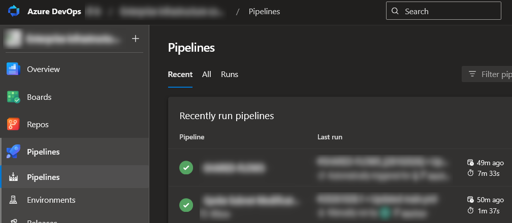
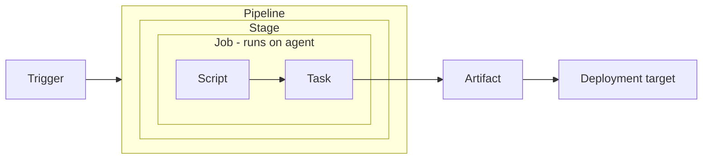
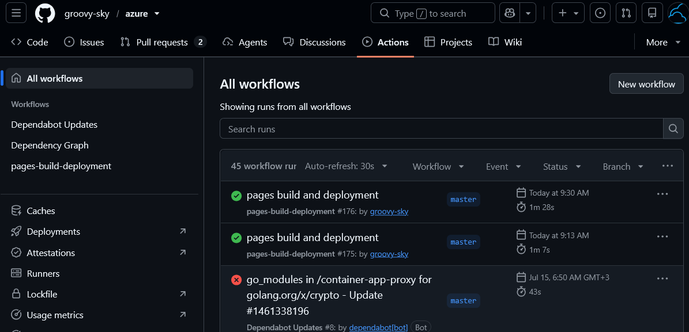
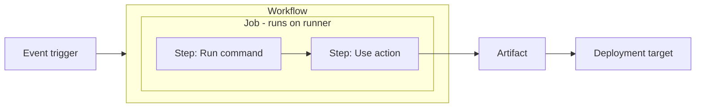

# Migrate from Azure DevOps to GitHub (part 2)

This part compares **Azure Pipelines** and **GitHub Actions**: how they organize work, what starts a run, where jobs execute, and how to translate common CI/CD concepts.

The Azure examples focus on YAML pipelines. Classic pipelines use a visual editor, and some details differ.

## Azure Pipelines

**Azure Pipelines** automates workflows such as building, testing, packaging, and deploying applications.



**Pipeline** describes the complete process -> each **stage** groups related work -> each **job** defines a unit of execution -> and each **step** performs one operation within that job:



| Component | Meaning |
|---|---|
| **Pipeline** | The complete automated workflow. |
| **Stage** | A logical section, such as Build, Test, or Deploy. |
| **Job** | A sequence of steps scheduled to run as a unit. |
| **Step** | An individual operation, such as running a script or task. |
| **Task** | A prebuilt operation used within a step. |

### Trigger (what starts a run)

A pipeline can start : 
- after a code change
- on a schedule
- after another pipeline
- manually

### Agent (where jobs execute)

An **agent** executes an agent-based job. An **agent pool** groups available agents.

| Common agent option | What it means |
|---|---|
| **Microsoft-hosted** | Microsoft supplies and maintains the execution environment. Each job gets a fresh virtual machine. |
| **Self-hosted** | Your organization supplies and maintains the execution environment. |


## GitHub Actions



**GitHub Actions** runs automated **workflows** and has much simpler structure compared to Azure Pipelines:



| Component | Meaning |
|---|---|
| **Workflow**/**Action** | The complete automated process defined in .github/workflows/*.yml or .github/workflows/*.yaml files. |
| **Job** | A unit of work containing steps, or a call to a reusable workflow. |
| **Step** | An individual operation within a job. |


Steps execute commands or use actions. Independent jobs can run in parallel, subject to available capacity and limits.

Unlike Azure Pipelines, GitHub Actions has **no separate stage construct**. 

### Trigger (what starts a run)
Configure triggering events under `on`. Common examples include:

| Event | Typical use |
|---|---|
| `push` | Run after commits are pushed. |
| `pull_request` | Validate pull-request changes. |
| `workflow_dispatch` | Allow manual runs. |
| `schedule` | Run on a schedule. |
| `workflow_run` | React to another workflow’s activity. |

Some events require the workflow file to exist on the repository’s default branch. 

### Runner (where jobs execute)

A **runner** executes a job. **Runner groups** help control access to sets of runners.

| Runner type | What it means |
|---|---|
| **Standard GitHub-hosted** | GitHub supplies and maintains the execution environment. |
| **Larger GitHub-hosted** | GitHub provides additional compute resources and capabilities for eligible plans. |
| **Self-hosted** | Your organization supplies and maintains the execution environment. |

Choose a runner using `runs-on`, for example:

```yaml
runs-on: ubuntu-latest
```

Other common labels include `windows-latest` and `macos-latest`. Hardware and availability depend on the label and repository type. The `latest` labels refer to GitHub’s supported stable images, not necessarily the newest OS release. 


### 7. Recognize the important settings

| Setting | Why it matters |
|---|---|
| **Configuration variables** | Provide reusable values through `vars`. |
| **Environment variables** | Provide values to processes through `env`. |
| **Inputs** | Customize manually triggered or reusable workflows. |
| **Dependencies** | Control job order with `needs`. |
| **Conditions** | Control execution with `if`. |
| **Permissions** | Limit the workflow’s `GITHUB_TOKEN` access. |

## Azure Pipelines vs. GitHub Actions

Use this table as a **conceptual mapping**, not a one-to-one syntax conversion.

| Concept | Azure Pipelines | GitHub Actions |
|---|---|---|
| Complete workflow | Pipeline | Workflow |
| One execution | Pipeline run | Workflow run |
| Definition | YAML or Classic editor | YAML in `.github/workflows/` |
| Major sections | Stages containing jobs | Jobs connected by dependencies |
| Unit of scheduled work | Job | Job |
| Individual operation | Step | Step |
| Reusable step tooling | Task | Action |
| Run commands | `script:`, `bash:`, or other script steps | `run:` |
| Execution resources | Agents and agent pools | Runners, labels, and runner groups |
| Select resources | `pool`, including hosted `vmImage` | `runs-on` |
| Dependencies | `dependsOn` | `needs` |
| Conditional execution | `condition` | `if` |
| Repeat with variations | Job matrix | Job matrix |
| Reuse automation | Templates | Composite actions and reusable workflows |
| Preserve files | Pipeline/build artifacts | Workflow artifacts |

The terminology overlaps, but execution rules, expression syntax, and reuse mechanisms differ. ([learn.microsoft.com](https://learn.microsoft.com/en-us/azure/devops/pipelines/?view=azure-devops))