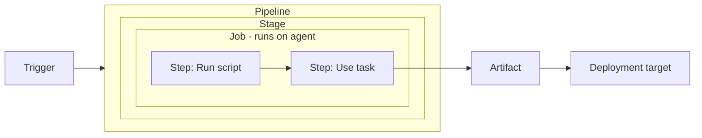
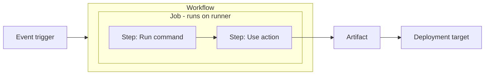
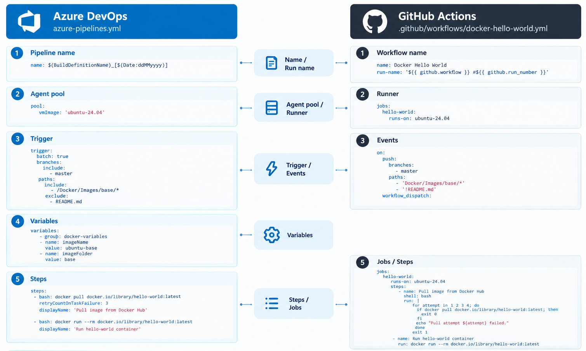

# Migrate from Azure DevOps to GitHub (part 2)

## Introduction

The [previous article](../devops-to-github-00/README.md) introduced CI/CD and the main features of Azure DevOps and GitHub. This second part focuses on moving automation from **Azure Pipelines** to **GitHub Actions**.

This document explains the main concepts of Azure Pipelines and GitHub Actions, highlighting their differences.

## Azure Pipelines

**Azure Pipelines** automates workflows such as building, testing, packaging, and deploying applications.


A **pipeline** describes the complete process → each **stage** groups related work → each **job** defines a unit of execution → and each **step** performs one operation within that job.



| Component | Meaning |
|---|---|
| **Pipeline** | The complete automated workflow. |
| **Stage** | A logical section, such as Build, Test, or Deploy. |
| **Job** | A sequence of steps scheduled to run as a unit. |
| **Step** | An individual operation, such as running a script or task. |
| **Task** | A prebuilt operation used within a step. |

### Trigger (what starts a run)

A pipeline can start:

- after a code change
- on a schedule
- after another pipeline
- manually

### Agent (where jobs execute)

An **agent** executes an agent-based job. An **agent pool** groups available agents.

| Common agent option | What it means |
|---|---|
| **Microsoft-hosted** | Microsoft supplies and maintains the execution environment. Each job gets a fresh virtual machine. |
| **Self-hosted** | Your organization supplies and maintains the execution environment. |

## GitHub Actions


**GitHub Actions** runs automated **workflows** organized into jobs and steps. An **action** is a reusable operation that a workflow can invoke within a step; it is not another name for a workflow.



| Component | Meaning |
|---|---|
| **Workflow** | The complete automated process defined in a `.github/workflows/*.yml` or `.github/workflows/*.yaml` file. |
| **Job** | A unit of work containing steps, or a call to a reusable workflow. |
| **Step** | An individual operation within a job that runs commands or invokes an action. |
| **Action** | A reusable operation invoked from a step using `uses:`. |

Steps execute commands using `run:` or invoke actions using `uses:`. Independent jobs can run in parallel, subject to available capacity and limits.

Unlike Azure Pipelines, GitHub Actions has **no separate stage construct**.

### Trigger (what starts a run)

Configure triggering events under `on`. Common examples include:

| Event | Typical use |
|---|---|
| `push` | Run after commits are pushed. |
| `pull_request` | Validate pull-request changes. |
| `workflow_dispatch` | Allow manual runs. |
| `schedule` | Run on a schedule. |
| `workflow_run` | React to another workflow’s activity. |

Some events require the workflow file to exist on the repository’s default branch.

### Runner (where jobs execute)

A **runner** executes a job. **Runner groups** help control access to sets of runners.

| Runner type | What it means |
|---|---|
| **Standard GitHub-hosted** | GitHub supplies and maintains the execution environment. |
| **Larger GitHub-hosted** | GitHub provides additional compute resources and capabilities for eligible plans. |
| **Self-hosted** | Your organization supplies and maintains the execution environment. |

Choose a runner using `runs-on`, for example:

```yaml
runs-on: ubuntu-latest
```

Other common labels include `windows-latest` and `macos-latest`. Hardware and availability depend on the label and repository type. The `latest` labels refer to GitHub’s supported stable images, not necessarily the newest OS release.

## Azure Pipelines vs. GitHub Actions

Use this table as a **conceptual mapping**, not a one-to-one syntax conversion.

| Concept | Azure Pipelines | GitHub Actions |
|---|---|---|
| Complete workflow | Pipeline | Workflow |
| One execution | Pipeline run | Workflow run |
| Definition | YAML or Classic editor | YAML in `.github/workflows/` |
| Major sections | Stages containing jobs | Jobs connected by dependencies |
| Unit of scheduled work | Job | Job |
| Individual operation | Step | Step |
| Reusable packaged operation | Task | Action |
| Run commands | `script:`, `bash:`, or other script steps | `run:` |
| Execution resources | Agents and agent pools | Runners, labels, and runner groups |
| Select resources | `pool`, including hosted `vmImage` | `runs-on` |
| Dependencies | `dependsOn` | `needs` |
| Conditional execution | `condition` | `if` |
| Repeat with variations | Job matrix | Job matrix |
| Reuse automation | Templates | Composite actions and reusable workflows |
| Batch CI changes | `trigger.batch: true` | No direct equivalent; concurrency controls are not a one-to-one replacement |
| Shared configuration group | Variable groups | No direct equivalent; variables and secrets must be mapped separately |
| Preserve files | Pipeline/build artifacts | Workflow artifacts |

## Pipeline vs Workflow Comparison

The following examples show how a simple Azure Pipeline can be represented as a GitHub Actions workflow. They demonstrate comparable commands, but **do not preserve every configuration setting or execution behavior**.

Pipeline example:

```yaml
name: $(BuildDefinitionName)_[$(Date:ddMMyyyy)]

pool:
  vmImage: 'ubuntu-24.04'

trigger:
  batch: true
  branches:
    include:
    - master
  paths:
    include:
    - /Docker/Images/base/*
    exclude:
    - README.md

variables:
  - group: docker-variables
  - name: imageName
    value: ubuntu-base
  - name: imageFolder
    value: base

steps:

- bash: docker pull docker.io/library/hello-world:latest
  retryCountOnTaskFailure: 3
  displayName: 'Pull image from Docker Hub'

- bash: docker run --rm docker.io/library/hello-world:latest
  displayName: 'Run hello-world container'
```

Workflow example:

```yaml
name: Docker Hello World
run-name: '${{ github.workflow }} #${{ github.run_number }}'

on:
  push:
    branches:
      - master
    paths:
      - 'Docker/Images/base/*'
      - '!README.md'
  workflow_dispatch:

jobs:
  hello-world:
    runs-on: ubuntu-24.04
    steps:
      - name: Pull image from Docker Hub
        shell: bash
        run: |
          for attempt in 1 2 3 4; do
            if docker pull docker.io/library/hello-world:latest; then
              exit 0
            fi
            echo "Pull attempt ${attempt} failed."
          done
          exit 1

      - name: Run hello-world container
        run: docker run --rm docker.io/library/hello-world:latest
```

### Settings without direct equivalents

#### CI batching

The Azure Pipeline uses:

```yaml
trigger:
  batch: true
```

This batches changes received while a pipeline run is in progress. After that run finishes, Azure Pipelines starts another run containing the changes that have not yet been built.

**GitHub Actions has no direct equivalent to Azure Pipelines’ `trigger.batch` setting.** Its concurrency controls can limit overlapping runs, but they are not a one-to-one replacement for CI batching.

The workflow above therefore does **not** preserve the Azure Pipeline’s batching behavior.

#### Variable groups

The Azure Pipeline references a variable group:

```yaml
variables:
  - group: docker-variables
```

**GitHub Actions has no direct equivalent to an Azure Pipelines variable group.** Repository-, organization-, and environment-level variables and secrets provide related configuration capabilities, but a variable group cannot be translated directly as a single workflow declaration.

To migrate a variable group, map its non-secret values and secrets to the appropriate GitHub configuration scopes, then update the workflow to reference them.

The workflow above omits `docker-variables`, `imageName`, and `imageFolder` because the shown commands do not explicitly use them. Their migration is not demonstrated by this example.

### Retry behavior

The Azure Pipeline specifies three retries after the initial attempt:

```yaml
retryCountOnTaskFailure: 3
```

The GitHub Actions workflow implements this explicitly with a loop allowing **four total attempts**: one initial attempt and up to three retries.



## Summary

**Azure Pipelines** and **GitHub Actions** are CI/CD services built around similar ideas: triggers start runs, jobs organize work, and steps execute on agents/runners.

A **pipeline** corresponds conceptually to a **workflow**, a **step** corresponds to a **step**, and an Azure Pipelines **task** corresponds conceptually to a GitHub **action**.

Migration requires more than translating terminology and YAML syntax. Settings such as **CI batching** and **variable groups** have no direct GitHub Actions equivalents and require separate migration decisions.
