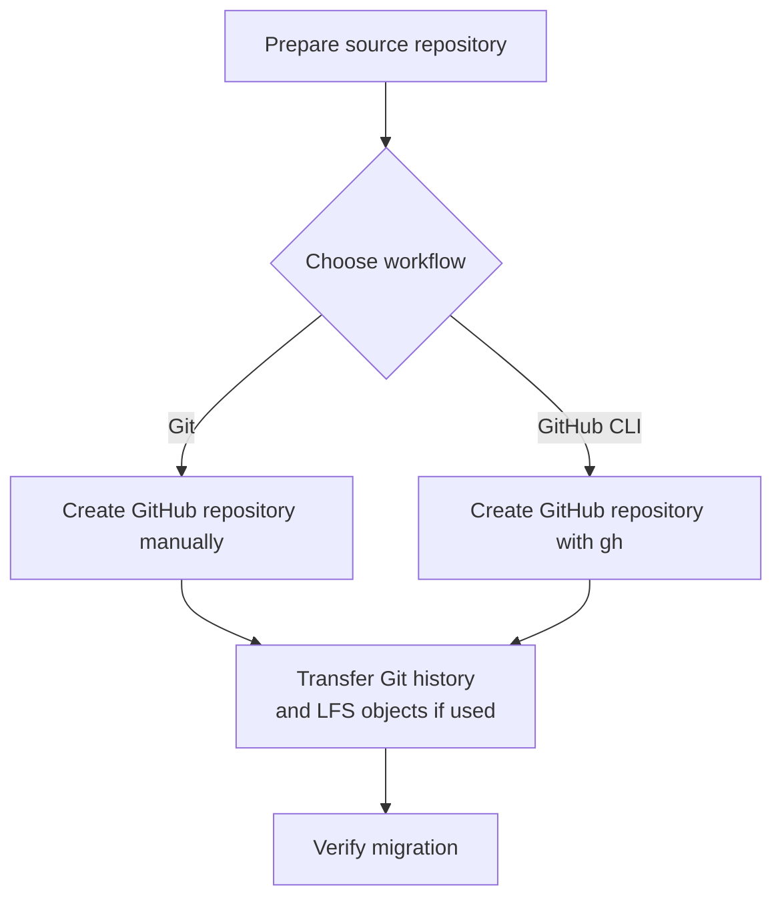

# Migrate from Azure DevOps to GitHub - Part 3: Git Repository Migration

**Tutorial series: Part 3 of 4.** **Previous:** [Part 2: Azure Pipelines to GitHub Actions](../devops-to-github-01/README.md).

## Introduction

Moving a repository to GitHub requires more than copying its current files. Branches, tags, commit history, and any Git LFS objects need to be transferred too.

This part shows how to transfer the repository using Git or GitHub CLI and perform basic checks afterward. Pipelines, permissions, and other integrations are outside this transfer.

## Series Overview

- [Migrate from Azure DevOps to GitHub - Part 1: Platform Concepts](../devops-to-github-00/README.md)
- [Migrate from Azure DevOps to GitHub - Part 2: Azure Pipelines to GitHub Actions](../devops-to-github-01/README.md)
- **Migrate from Azure DevOps to GitHub - Part 3: Git Repository Migration (this article)**
- [Migrate from Azure DevOps to GitHub - Part 4: Service Connections](../devops-to-github-03/README.md)

## Prepare for Migration

### Prerequisites

Ensure you have:

- Permission to clone the Azure DevOps repository.
- Permission to create or update the destination repository on GitHub.
- Git installed.
- A fresh local directory for the migration.

Depending on your repository and preferred workflow, you may also need:

| Tool | When it is needed |
|---|---|
| **GitHub CLI (`gh`)** | If you want to create the destination repository from the terminal. |
| **Git LFS** | If the source repository uses LFS, or ordinary Git files need conversion to LFS before migration. |

For migrations to GitHub Enterprise Cloud, you can also use , a dedicated migration tool. 

### Coordinate the Final Copy

Before transferring the repository:

- [ ] Push all changes that must be included.
- [ ] Ask collaborators to pause pushes to Azure DevOps.
- [ ] Check whether the repository uses Git LFS.
- [ ] Identify files larger than 100 MB stored in ordinary Git history; these may need conversion to LFS before migration.

### Command Conventions

Run the examples in **Bash or Git Bash**. Replace all placeholders with your repository details.

Copy the source URL from:

**Azure DevOps → Repos → Files → Clone**

The example URLs use these formats:

```text
Source:
https://dev.azure.com/{organization}/{project}/_git/{repo}

Destination:
https://github.com/{owner}/{new-repo}.git
```

## Choose a Migration Workflow

Choose **one** of the following workflows:

| Workflow | Destination creation | Repository transfer |
|---|---|---|
| **Option A: Git** | Create an empty repository on GitHub manually. | Use Git commands. |
| **Option B: GitHub CLI** | Create the repository with `gh repo create`. | Use GitHub CLI and, when needed, Git LFS and Git commands. |

Both workflows include an LFS path.



**Note:** Converting ordinary Git files to LFS is a preparation task; the conversion procedure is not covered below.

## Option A: Migrate Using Git

### Step 1: Create an Empty GitHub Repository

Create the repository under the intended GitHub user or organization.

**Do not initialize it with a README, license, or `.gitignore`.**

### Step 2: Clone Azure DevOps and Add the GitHub Remote

```bash
git clone --bare \
  "https://dev.azure.com/{organization}/{project}/_git/{repo}" \
  migration.git

cd migration.git

git remote add github \
  "https://github.com/{owner}/{new-repo}.git"
```

Confirm the remote URLs:

```bash
git remote -v
```

Expected configuration:

- `origin` points to Azure DevOps.
- `github` points to GitHub.

### Step 3: Transfer LFS Objects, If Applicable

Skip this step if the repository does not use Git LFS.

```bash
git lfs fetch --all origin &&
git lfs push --all github
```

Resolve any errors before continuing.

### Step 4: Push Git History and References

```bash
git push --dry-run --mirror github &&
git push --mirror github
```

Continue to **Section 6: Verify the Migration**.

## Option B: Migrate Using GitHub CLI

### Step 1: Authenticate with GitHub

```bash
gh auth login --hostname github.com --git-protocol https --web
gh auth setup-git
gh auth status
```

Confirm that the intended GitHub account is signed in.

**Azure DevOps authentication is separate:** GitHub CLI does not authenticate you to Azure DevOps. Complete the Azure sign-in when cloning.

### Step 2: Clone Azure DevOps

```bash
git clone --bare \
  "https://dev.azure.com/{organization}/{project}/_git/{repo}" \
  migration.git

cd migration.git
```

### Step 3: Create and Populate the GitHub Repository

Choose the appropriate path below.

#### Path A: Repository Without Git LFS

Create the repository and push immediately:

```bash
gh repo create {owner}/{new-repo} \
  --private \
  --source=. \
  --remote=github \
  --push
```

Because the source is a bare repository, `--push` mirrors its references.

#### Path B: Repository With Git LFS

First, create the destination without pushing:

```bash
gh repo create {owner}/{new-repo} \
  --private \
  --source=. \
  --remote=github
```

Then transfer LFS objects and Git history:

```bash
git lfs fetch --all origin &&
git lfs push --all github &&
git push --dry-run --mirror github &&
git push --mirror github
```

Resolve any errors before proceeding.

## Verify the Migration

Updated todo list

Open `https://github.com/{owner}/{new-repo}` and confirm that the expected files, branches, tags, and commit history are present. Check that the correct default branch is set. These visual checks do not verify LFS downloads or integrations.

## Summary

The repository is now transferred to GitHub, including its Git history and any LFS objects. Basic visual checks confirm the expected content is present; LFS downloads and integrations still need separate verification.

Next, we will configure workflow access to external services in [Part 4: Service Connections](../devops-to-github-03/README.md).
