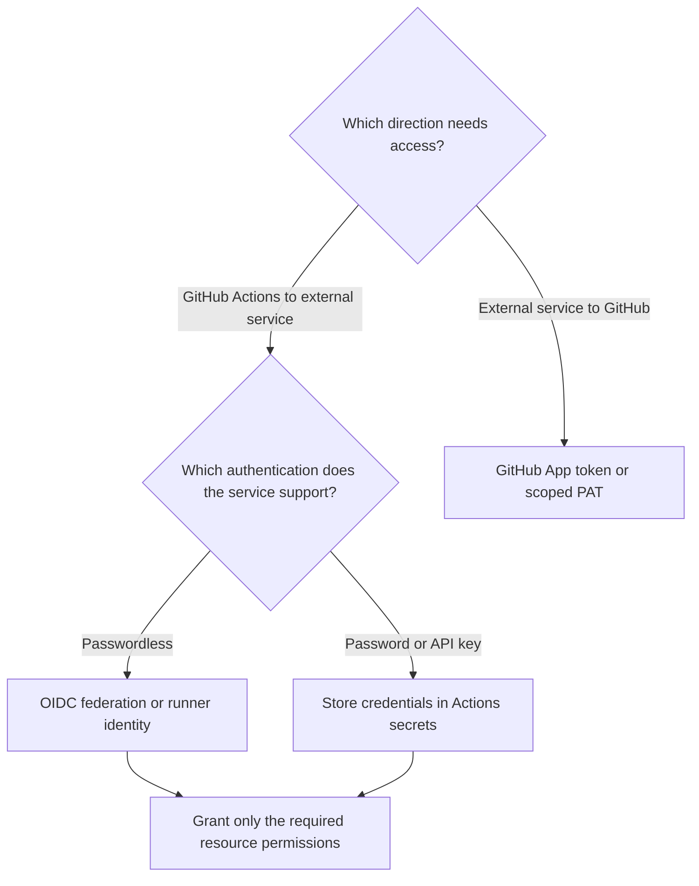

# Migrate from Azure DevOps to GitHub — Part 4: Service Connections

## Introduction

The [first article](../devops-to-github-00/README.md) introduced Azure DevOps and GitHub. [Part 2](../devops-to-github-02/README.md) compared Azure Pipelines with GitHub Actions, and [Part 3](../devops-to-github-01/README.md) covered Git repository migration.

This guide explains how to provide access controls in GitHub Actions similar to those offered by Azure Pipelines service connections.

The important distinction is architectural:

- **Azure Pipelines** represents an external connection as a named, managed resource.
- **GitHub Actions** assembles authentication from workflow permissions, provider-side identity configuration, secrets or tokens, and login actions or commands. These components are not a one-to-one replacement for a service connection.

**Migration means recreating trust, authorization, and deployment controls—not just translating YAML.**

## Azure Pipelines service connections

A **service connection** holds the connection settings and authentication configuration used to reach an external service. Connection types include Azure Resource Manager, Docker Registry, Kubernetes, and GitHub. Manage them under **Project settings → Service connections**. ([learn.microsoft.com](https://learn.microsoft.com/en-us/azure/devops/pipelines/library/service-endpoints?view=azure-devops))


A task references the connection by name:

```yaml
steps:
  - task: AzureCLI@2
    inputs:
      azureSubscription: production-azure
      scriptType: bash
      scriptLocation: inlineScript
      inlineScript: az account show
```

An **Azure Resource Manager** service connection using **workload identity federation (WIF)** lets a pipeline authenticate to Azure without a client secret. You must still grant the identity used by the connection an appropriate **Azure RBAC role** on the resources the pipeline needs to access. ([learn.microsoft.com](https://learn.microsoft.com/en-us/azure/devops/pipelines/release/configure-workload-identity?view=azure-devops))

## Choose the GitHub Actions authentication method

Start with the target service and the access the workflow actually needs.

| Method | Use it when | Important boundary |
|---|---|---|
| **OIDC federation** | A cloud provider supports exchanging GitHub identity tokens for short-lived credentials | Provider trust and resource permissions must also be configured |
| **Actions secrets** | A service requires a static credential | Secret storage does not remove the need for rotation |
| **`GITHUB_TOKEN`** | The job needs supported access to its own GitHub repository | It is not an Azure credential or a general cross-repository token |
| **GitHub App installation token** | GitHub automation needs access beyond the built-in token | Access depends on the app’s installation and granted permissions |
| **PAT** | A GitHub integration requires user-based token authentication | Treat it as a managed credential with limited permissions and expiry |
| **Runner identity** | A suitably configured self-hosted runner can use an existing machine identity | The runner and every workflow allowed to execute on it become part of the trust boundary |

Github token allows to access a repository, same as a PAT, but it is automatically generated and scoped to the workflow run. Github app also provides a way to authenticate with GitHub APIs, but its access depends on the app’s installation and granted permissions. All these mechanisms gives access to Github resources, not external services.

For accessing external services from a GitHub workflow, you need to use the authentication mechanism supported by that service, such as OIDC federation, service-specific secrets, or managed identities. GitHub-provided tokens like `GITHUB_TOKEN` or PATs are not suitable for authenticating to external APIs.



## Example: replace an Azure connection with GitHub OIDC

This example uses an environment-bound GitHub job to authenticate to Azure without a client secret.

### 


```
name: Repository Info

on:
  workflow_dispatch:

permissions: {}

jobs:
  repository-info:
    runs-on: ubuntu-24.04
    timeout-minutes: 5
    outputs:
      repository_id: ${{ github.repository_id }}
      repository_owner_id: ${{ github.repository_owner_id }}
    steps:
      - name: Return Repository and Owner IDs
        env:
          REPOSITORY_ID: ${{ github.repository_id }}
          REPOSITORY_OWNER_ID: ${{ github.repository_owner_id }}
        run: |
          printf 'Repository ID: `%s`\nRepository owner ID: `%s`\n' \
            "$REPOSITORY_ID" "$REPOSITORY_OWNER_ID" | tee -a "$GITHUB_STEP_SUMMARY"
```

### 1. Create or select the Azure identity

Use either:

- A Microsoft Entra application with a service principal.
- A **user-assigned managed identity**.

Assign only the Azure RBAC role and resource scope required by the deployment. Record the client ID, tenant ID, and subscription ID. ([learn.microsoft.com](https://learn.microsoft.com/en-us/azure/developer/github/connect-from-azure-openid-connect))

Do not assume that the Azure DevOps federated credential can be reused unchanged. GitHub needs its own trust configuration for GitHub-issued tokens. ([learn.microsoft.com](https://learn.microsoft.com/en-us/azure/devops/pipelines/release/configure-workload-identity?view=azure-devops))

### 2. Configure federated trust

For Azure public cloud, configure the identity’s federated credential with:

| Field | Value |
|---|---|
| Issuer | `https://token.actions.githubusercontent.com` |
| Audience | `api://AzureADTokenExchange` |
| Subject | The exact subject produced by the intended GitHub job |

Because the workflow below references `environment: production`, use the repository’s **environment-based subject**, not a branch-based subject. GitHub’s default subject uses the environment context when a job references an environment. ([docs.github.com](https://docs.github.com/en/actions/how-tos/secure-your-work/security-harden-deployments/oidc-in-azure))

For the older name-based format:

```text
repo:OWNER/REPOSITORY:environment:production
```

For the immutable-ID format:

```text
repo:OWNER@OWNER_ID/REPOSITORY@REPOSITORY_ID:environment:production
```

These are templates. Replace the placeholders and confirm the repository’s actual OIDC configuration, including any subject customization. ([docs.github.com](https://docs.github.com/en/actions/reference/security/oidc))

> **Subject-format change:** Since July 15, 2026, GitHub applies the immutable default format to newly created repositories and repositories renamed or transferred after that date. Existing repositories retain the previous format unless they opt in. This change applies to GitHub.com, not GitHub Enterprise Server. Do not assume every repository uses the same format. ([docs.github.com](https://docs.github.com/en/actions/how-tos/secure-your-work/security-harden-deployments/oidc-in-azure))

### 3. Configure the GitHub environment

Create a `production` environment and configure:

- Allowed deployment branches or tags.
- Required reviewers, where available.
- Prevention of self-review, where appropriate.
- The configuration variables used by the workflow.

**Check feature availability first.** Environment features depend on the GitHub plan and repository visibility. On GitHub Free, Pro, and Team, required reviewers and wait timers are available only for public repositories. ([docs.github.com](https://docs.github.com/en/actions/how-tos/deploy/configure-and-manage-deployments/manage-environments))

Define these variables:

```text
AZURE_CLIENT_ID
AZURE_TENANT_ID
AZURE_SUBSCRIPTION_ID
```

These identifiers are not client secrets; the workflow still requires a matching federated credential and Azure authorization to authenticate successfully. ([learn.microsoft.com](https://learn.microsoft.com/en-us/azure/developer/github/connect-from-azure-openid-connect))

### 4. Add the workflow

```yaml
name: Verify Azure authentication

on:
  workflow_dispatch:

permissions: {}

jobs:
  verify:
    runs-on: ubuntu-latest
    environment: production

    permissions:
      id-token: write

    steps:
      - name: Sign in to Azure
        uses: azure/login@v2
        with:
          client-id: ${{ vars.AZURE_CLIENT_ID }}
          tenant-id: ${{ vars.AZURE_TENANT_ID }}
          subscription-id: ${{ vars.AZURE_SUBSCRIPTION_ID }}

      - name: Show selected Azure subscription
        run: |
          az account show \
            --query '{subscription:id, tenant:tenantId}' \
            --output json
```

`id-token: write` lets the job request an OIDC token. It does **not** grant write access to Azure; federated trust controls whether Azure accepts the identity, and Azure RBAC controls its resource access. This example does not check out repository content, so it does not request `contents: read`. ([docs.github.com](https://docs.github.com/en/actions/how-tos/secure-your-work/security-harden-deployments/oidc-in-azure))

The login action establishes authentication for subsequent Azure commands. It does not deploy anything by itself. ([github.com](https://github.com/Azure/login))

## Practical part


> **GitHub service connection ≠ GitHub Actions service connection.** Azure Pipelines’ GitHub connection type authenticates an Azure pipeline to GitHub. It is not an object that GitHub Actions uses to authenticate to Azure. ([learn.microsoft.com](https://learn.microsoft.com/en-us/azure/devops/pipelines/library/service-endpoints?view=azure-devops))

## Summary

Treat this migration as an identity-and-controls migration.

For each connection, answer four questions:

- **Who** will the GitHub job authenticate as?
- **Which workflow context** may use that identity?
- **What resources and operations** may it access?
- **Which approvals and restrictions** must apply before it runs?

Only then translate the YAML.