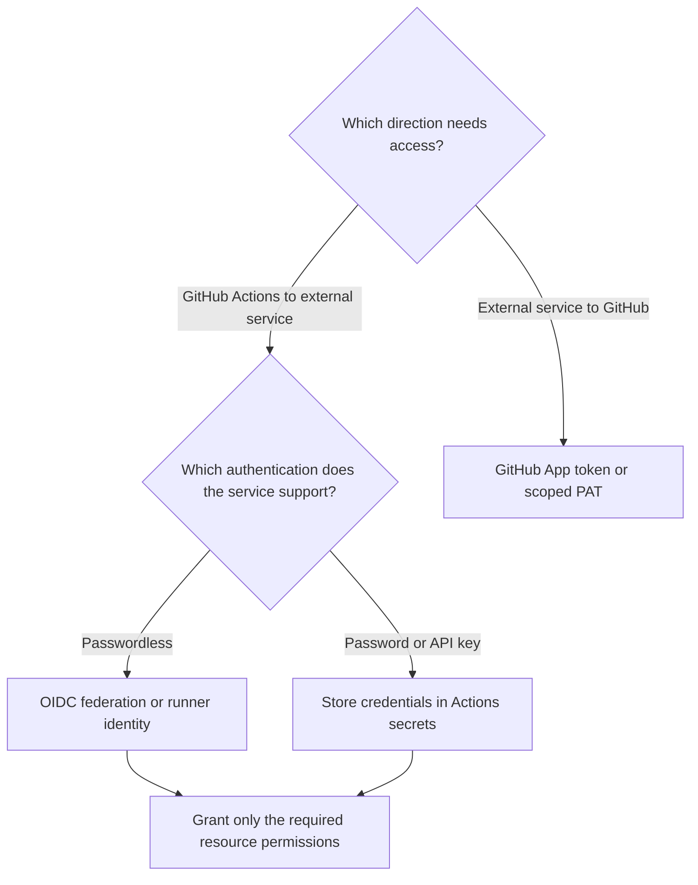

# Migrate from Azure DevOps to GitHub — Part 4: Service Connections

## Introduction

The first article introduced Azure DevOps and GitHub. Part 2 compared Azure Pipelines with GitHub Actions, and Part 3 covered Git repository migration.

This guide explains how to provide access controls in GitHub Actions similar to those offered by Azure Pipelines service connections.

The important distinction is architectural:

- **Azure Pipelines** represents an external connection as a named, managed resource.
- **GitHub Actions** assembles authentication from workflow permissions, provider-side identity configuration, secrets or tokens, and login actions or commands. These components are not a one-to-one replacement for a service connection.

**Migration means recreating trust, authorization, and deployment controls—not just translating YAML.**

## Azure Pipelines service connections


A **service connection** holds the connection settings and authentication configuration used to reach an external service. Connection types include Azure Resource Manager, Docker Registry, Kubernetes, and GitHub. Manage them under **Project settings → Service connections**. ([learn.microsoft.com](https://learn.microsoft.com/en-us/azure/devops/pipelines/library/service-endpoints?view=azure-devops))


A task references the connection by name:

```
steps:
  - task: AzureCLI@2
    inputs:
      azureSubscription: production-azure
      scriptType: bash
      scriptLocation: inlineScript
      inlineScript: az account show
```

An **Azure Resource Manager** service connection using **workload identity federation (WIF)** lets a pipeline authenticate to Azure without a client secret. You must still grant the identity used by the connection an appropriate **Azure RBAC role** on the resources the pipeline needs to access. ([learn.microsoft.com](https://learn.microsoft.com/en-us/azure/devops/pipelines/release/configure-workload-identity?view=azure-devops))

## Choose the GitHub Actions authentication method

Start with the target service and the access the workflow actually needs.

| Method                            | Use it when                                                                             | Important boundary                                                                       |
| --------------------------------- | --------------------------------------------------------------------------------------- | ---------------------------------------------------------------------------------------- |
| **OIDC federation**               | A cloud provider supports exchanging GitHub identity tokens for short-lived credentials | Provider trust and resource permissions must also be configured                          |
| **Actions secrets**               | A service requires a static credential                                                  | Secret storage does not remove the need for rotation                                     |
| **`GITHUB_TOKEN`**                | The job needs supported access to its own GitHub repository                             | It is not an Azure credential or a general cross-repository token                        |
| **GitHub App installation token** | GitHub automation needs access beyond the built-in token                                | Access depends on the app's installation and granted permissions                         |
| **PAT**                           | A GitHub integration requires user-based token authentication                           | Treat it as a managed credential with limited permissions and expiry                     |
| **Runner identity**               | A suitably configured self-hosted runner can use an existing machine identity           | The runner and every workflow allowed to execute on it become part of the trust boundary |

GitHub's `GITHUB_TOKEN` allows access to repository resources and is automatically generated and scoped to the workflow run. A GitHub App also provides a way to authenticate with GitHub APIs, but its access depends on the app's installation and granted permissions.

These mechanisms provide access to GitHub resources, not external services.

For accessing external services from a GitHub workflow, use the authentication mechanism supported by that service, such as OIDC federation, service-specific secrets, or managed identities. GitHub-provided tokens like `GITHUB_TOKEN` or PATs are not suitable for authenticating to external APIs.



## Configure Azure connection with GitHub OIDC

This example uses a **User Assigned Managed Identity** and a branch-bound GitHub federated credential to authenticate to Azure without a client secret.

### 1. Create or select the Azure identity

Use a Microsoft Entra application with a service principal or, as in this example, a **User Assigned Managed Identity**.

In Azure Portal, open **Managed Identities → Create**, choose the subscription, resource group and region, and name it `azure-identity`. Select **Review + create → Create**.

Collect the **Client ID** (authentication), **Principal ID** (RBAC assignments), **Tenant ID** (Entra tenant) and **Subscription ID** (Azure subscription).

At the required resource scope, open **Access control (IAM) → Add role assignment**. Choose **Reader → Managed identity → User-assigned managed identity** and select `azure-identity`. Reader supports read-only validation; deployments need permissions appropriate to the resources they manage. Grant only the required role and scope.

GitHub needs its own federated trust configuration; do not reuse the Azure DevOps credential unchanged. ([learn.microsoft.com](https://learn.microsoft.com/en-us/azure/developer/github/connect-from-azure-openid-connect))

### 2. Configure federated trust

On the managed identity, open **Settings → Federated credentials → Add credential**, select **GitHub Actions deploying Azure resources**, and enter:

| Field           | Example      |
| --------------- | ------------ |
| Organization    | `groovy-sky` |
| Organization ID | `40501227`   |
| Repository      | `azure`      |
| Repository ID   | `1398660921` |
| Entity          | Branch       |
| Branch          | `master`     |

For Azure public cloud, verify:

| Field    | Value                                                      |
| -------- | ---------------------------------------------------------- |
| Issuer   | `https://token.actions.githubusercontent.com`              |
| Audience | `api://AzureADTokenExchange`                               |
| Subject  | The exact subject produced by the intended GitHub workflow |

Older name-based subject:

```
repo:OWNER/REPOSITORY:ref:refs/heads/master
```

Immutable-ID subject:

```
repo:OWNER@OWNER_ID/REPOSITORY@REPOSITORY_ID:ref:refs/heads/master
```

For this example:

```
repo:groovy-sky@40501227/azure@1398660921:ref:refs/heads/master
```

Replace placeholders and confirm the repository's actual OIDC subject, including customizations. ([docs.github.com](https://docs.github.com/en/actions/reference/security/oidc))

> **Subject-format change:** Since July 15, 2026, new, renamed or transferred GitHub.com repositories use the immutable default. Existing repositories keep the older format unless they opt in. This does not apply to GitHub Enterprise Server; verify each repository's format. ([docs.github.com](https://docs.github.com/en/actions/how-tos/secure-your-work/security-harden-deployments/oidc-in-azure))

Name the credential `github-azure-master`, verify the values and select **Add**. This establishes trust, not Azure resource permissions.

### 3. Configure GitHub repository variables

Under repository **Settings → Secrets and variables → Actions → Variables**, add `AZURE_CLIENT_ID`, `AZURE_TENANT_ID` and `AZURE_SUBSCRIPTION_ID` using the collected values.

These are identifiers, not secrets. Matching federated trust and Azure authorization are still required. ([learn.microsoft.com](https://learn.microsoft.com/en-us/azure/developer/github/connect-from-azure-openid-connect))

### 4. Add the workflow

Create `.github/workflows/azure-oidc-test.yml`:

```
name: Verify Azure authentication

on:
  workflow_dispatch:
  push:
    branches:
      - master

permissions: {}

jobs:
  verify:
    runs-on: ubuntu-24.04

    permissions:
      id-token: write

    steps:
      - name: Sign in to Azure
        uses: azure/login@v2
        with:
          client-id: ${{ vars.AZURE_CLIENT_ID }}
          tenant-id: ${{ vars.AZURE_TENANT_ID }}
          subscription-id: ${{ vars.AZURE_SUBSCRIPTION_ID }}

      - name: Show selected Azure subscription
        run: |
          az account show \
            --query '{subscription:id, tenant:tenantId}' \
            --output json
```

`id-token: write` permits OIDC token requests, not Azure writes. Federated trust controls identity acceptance; Azure RBAC controls resource access.

`azure/login` authenticates subsequent Azure commands; it does not deploy resources. ([github.com](https://github.com/Azure/login))

### 5. Execute and validate the workflow

In **Actions → Verify Azure authentication → Run workflow**, select `master`. A successful run returns the selected subscription and tenant.

If authentication fails, check:

- GitHub organization and repository names and IDs.
- Branch name and federated subject.
- Issuer URL and audience.
- Managed identity Client ID, Tenant ID and Subscription ID.
- `id-token: write` workflow permission.
- Azure RBAC role assignments and scope.

## Practical part

The following screenshots illustrate the complete configuration process:


> **GitHub service connection ≠ GitHub Actions service connection.** Azure Pipelines' GitHub connection type authenticates an Azure pipeline to GitHub. It is not an object that GitHub Actions uses to authenticate to Azure. ([learn.microsoft.com](https://learn.microsoft.com/en-us/azure/devops/pipelines/library/service-endpoints?view=azure-devops))

## Summary

Treat this migration as an identity-and-controls migration.

For each connection, answer four questions:

- **Who** will the GitHub job authenticate as?
- **Which workflow context** may use that identity?
- **What resources and operations** may it access?
- **Which approvals and restrictions** must apply before it runs?

Only then translate the YAML.

Clarify the service-connection mappingAdd a migration mapping table