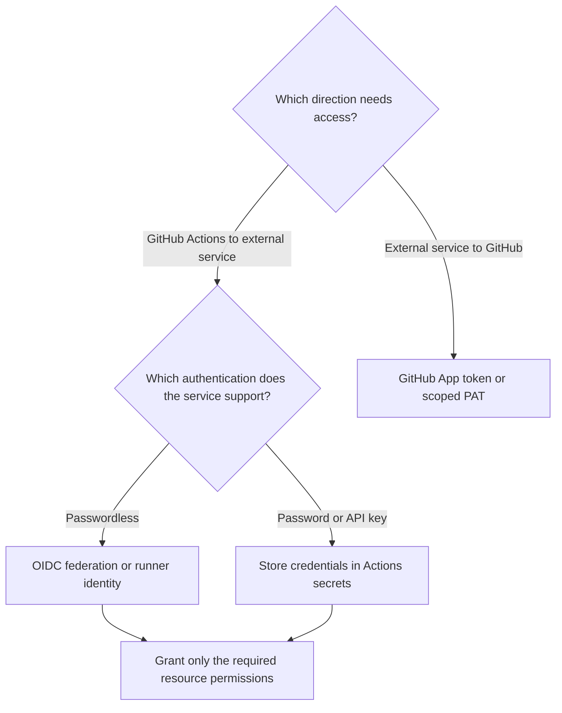
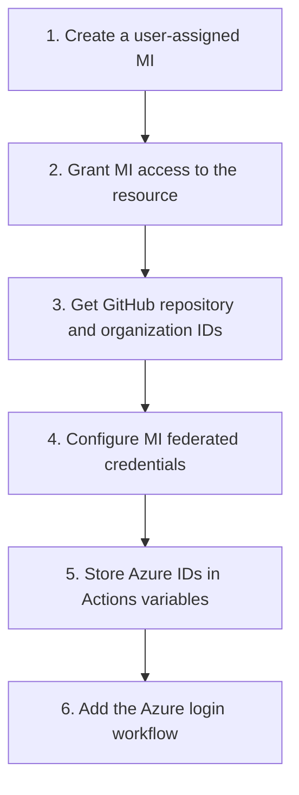
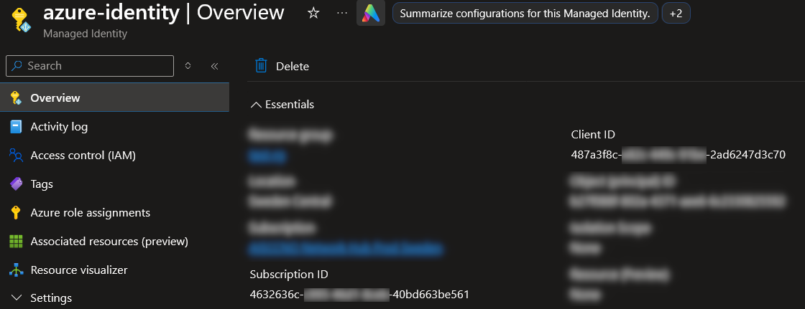

# Migrate from Azure DevOps to GitHub - Part 4: Service Connections

**Tutorial series: Part 4 of 4.** **Previous:** [Part 3: Git Repository Migration](../devops-to-github-02/README.md).

## Introduction

Moving a repository does not give GitHub Actions access to the services used by Azure Pipelines. Service connections do not transfer, so workflows need their own authentication and permissions.

This part explains the available approaches and shows how to configure and test Azure access using OpenID Connect (OIDC) and a user-assigned managed identity, without a client secret.

## Series Overview

| Part | Topic | Migration goal |
|---|---|---|
| [1](../devops-to-github-00/README.md) | Platform Concepts | Understand how Azure DevOps and GitHub organize code, work, and automation. |
| [2](../devops-to-github-01/README.md) | Azure Pipelines to GitHub Actions | Map automation concepts and identify settings that need redesign. |
| [3](../devops-to-github-02/README.md) | Git Repository Migration | Transfer Git history and LFS objects, then verify the destination. |
| **4 (this article)** | Service Connections | Recreate authentication, authorization, and access controls. |

## Azure Pipelines service connections


A **service connection** holds the connection settings and authentication configuration used to reach an external service. Connection types include Azure Resource Manager, Docker Registry, Kubernetes, and GitHub. Manage them under **Project settings → Service connections**. ([learn.microsoft.com](https://learn.microsoft.com/en-us/azure/devops/pipelines/library/service-endpoints?view=azure-devops))


A task references the connection by name:

```
steps:
  - task: AzureCLI@2
    inputs:
      azureSubscription: production-azure
      scriptType: bash
      scriptLocation: inlineScript
      inlineScript: az account show
```

An **Azure Resource Manager** service connection using **workload identity federation (WIF)** lets a pipeline authenticate to Azure without a client secret. You must still grant the identity used by the connection an appropriate **Azure RBAC role** on the resources the pipeline needs to access. ([learn.microsoft.com](https://learn.microsoft.com/en-us/azure/devops/pipelines/release/configure-workload-identity?view=azure-devops))

## Choose the GitHub Actions authentication method

Start with the target service and the access the workflow actually needs.

| Method                            | Use it when                                                                             | Important boundary                                                                       |
| --------------------------------- | --------------------------------------------------------------------------------------- | ---------------------------------------------------------------------------------------- |
| **OIDC federation**               | A cloud provider supports exchanging GitHub identity tokens for short-lived credentials | Provider trust and resource permissions must also be configured                          |
| **Actions secrets**               | A service requires a static credential                                                  | Secret storage does not remove the need for rotation                                     |
| **`GITHUB_TOKEN`**                | The job needs supported access to its own GitHub repository                             | It is not an Azure credential or a general cross-repository token                        |
| **GitHub App installation token** | GitHub automation needs access beyond the built-in token                                | Access depends on the app's installation and granted permissions                         |
| **PAT**                           | A GitHub integration requires user-based token authentication                           | Treat it as a managed credential with limited permissions and expiry                     |
| **Runner identity**               | A suitably configured self-hosted runner can use an existing machine identity           | The runner and every workflow allowed to execute on it become part of the trust boundary |

GitHub's `GITHUB_TOKEN` allows access to repository resources and is automatically generated and scoped to the workflow run. A GitHub App also provides a way to authenticate with GitHub APIs, but its access depends on the app's installation and granted permissions.

These mechanisms provide access to GitHub resources, not external services.

For accessing external services from a GitHub workflow, use the authentication mechanism supported by that service, such as OIDC federation, service-specific secrets, or managed identities. GitHub-provided tokens like `GITHUB_TOKEN` or PATs are not suitable for authenticating to external APIs.



## Configure Azure connection with GitHub OIDC

This example uses a **User Assigned Managed Identity** and a branch-bound GitHub federated credential to authenticate to Azure without a client secret.



### 1. Create the identity

To create a **User Assigned Managed Identity**:

- Open Azure Portal -> **Create a resource**  → **Managed Identities → Create**. Set subscription, resource group, region and name (`azure-identity`), then **Review + create → Create**.
- **Record:** Client ID (authentication), Principal ID (RBAC), Tenant ID and Subscription ID.

### 2. Assign required access to the identity

At the required scope, use **Access control (IAM) → Add role assignment** to assign **Reader** to the user-assigned managed identity `azure-identity`. Deployments may need additional permissions; keep role and scope minimal.

### 3. Obtain GitHub repository and organization IDs

To obtain the GitHub repository and organization IDs, create a workflow file in your repository (under `.github/workflows/` path, for example `.github/workflows/repository-info.yml`) with the following content:

```
name: Repository Info

on:
  workflow_dispatch:

permissions: {}

jobs:
  repository-info:
    runs-on: ubuntu-24.04
    timeout-minutes: 5
    outputs:
      repository_id: ${{ github.repository_id }}
      repository_owner_id: ${{ github.repository_owner_id }}
    steps:
      - name: Return Repository and Owner IDs
        env:
          REPOSITORY_ID: ${{ github.repository_id }}
          REPOSITORY_OWNER_ID: ${{ github.repository_owner_id }}
        run: |
          printf 'Repository ID: `%s`\nRepository owner ID: `%s`\n' \
            "$REPOSITORY_ID" "$REPOSITORY_OWNER_ID" | tee -a "$GITHUB_STEP_SUMMARY"
```

### 4. Configure federated trust

On the identity, open **Settings → Federated credentials → Add credential → GitHub Actions deploying Azure resources**. Configure and verify these Azure public-cloud values:

| Setting | Example |
| --- | --- |
| Organization / ID | `groovy-sky` / `40501227` |
| Repository / ID | `azure` / `1398660921` |
| Entity / Branch | Branch / `master` |
| Issuer | `https://token.actions.githubusercontent.com` |
| Audience | `api://AzureADTokenExchange` |
| Credential name | `github-azure-master` |

Match the subject to the workflow's actual OIDC configuration, including customizations:

| Format | Subject |
| --- | --- |
| Name-based | `repo:OWNER/REPOSITORY:ref:refs/heads/master` |
| Immutable-ID | `repo:OWNER@OWNER_ID/REPOSITORY@REPOSITORY_ID:ref:refs/heads/master` |
| Example | `repo:groovy-sky@40501227/azure@1398660921:ref:refs/heads/master` |

Replace placeholders and select **Add**. GitHub needs its own trust configuration, not an unchanged Azure DevOps credential; trust alone grants no resource access. ([learn.microsoft.com](https://learn.microsoft.com/en-us/azure/developer/github/connect-from-azure-openid-connect))

> Since July 15, 2026, new, renamed or transferred GitHub.com repositories default to immutable subjects; existing repositories retain the older format unless they opt in. GitHub Enterprise Server is excluded. Verify your repository's format and customizations. ([docs.github.com](https://docs.github.com/en/actions/reference/security/oidc))

### 5. Store Azure variables

In **Settings → Secrets and variables → Actions → Variables**, add `AZURE_CLIENT_ID`, `AZURE_TENANT_ID` and `AZURE_SUBSCRIPTION_ID` from step 1. These are identifiers, not secrets; trust and RBAC are still required.

### 6. Add the workflow

Create `.github/workflows/azure-oidc-test.yml`:

```
name: Verify Azure authentication

on:
  workflow_dispatch:
  push:
    branches:
      - master

permissions: {}

jobs:
  verify:
    runs-on: ubuntu-24.04

    permissions:
      id-token: write

    steps:
      - name: Sign in to Azure
        uses: azure/login@v2
        with:
          client-id: ${{ vars.AZURE_CLIENT_ID }}
          tenant-id: ${{ vars.AZURE_TENANT_ID }}
          subscription-id: ${{ vars.AZURE_SUBSCRIPTION_ID }}

      - name: Show selected Azure subscription
        run: |
          az account show \
            --query '{subscription:id, tenant:tenantId}' \
            --output json
```

`id-token: write` allows token requests, not Azure writes. Trust authenticates, RBAC authorizes, and `azure/login` signs in without deploying. ([github.com](https://github.com/Azure/login))

### 7. Run and validate

In **Actions → Verify Azure authentication → Run workflow**, select `master`. A successful run returns the selected subscription and tenant.

If it fails, check organization/repository names and IDs, branch and subject, issuer and audience, Azure IDs, `id-token: write`, and RBAC role/scope.

## Practical part

The following screenshots illustrate the complete configuration process:




> **GitHub service connection ≠ GitHub Actions service connection.** Azure Pipelines' GitHub connection type authenticates an Azure pipeline to GitHub. It is not an object that GitHub Actions uses to authenticate to Azure. ([learn.microsoft.com](https://learn.microsoft.com/en-us/azure/devops/pipelines/library/service-endpoints?view=azure-devops))

## Summary

The example workflow can now authenticate to Azure without a client secret. Federated trust controls which workflow can use the identity, while Azure RBAC controls what it can access.

This is the final part of the series. We covered platform differences, pipeline concepts, repository transfer, and external-service access; other integrations still require separate migration work.

**End of series.** Return to [Part 1: Platform Concepts and Series Overview](../devops-to-github-00/README.md).