# Migrate from Azure DevOps to GitHub - Part 5: Trigger GitHub Actions from Azure DevOps

**Tutorial series: Part 5 of 5.** **Previous:** [Part 4: Service Connections](../devops-to-github-03/README.md).

## Introduction

A migration can happen in stages: some automation stays in Azure DevOps while other jobs move to GitHub Actions. The two platforms need a way to work together during this transition.

Part 4 configured access from GitHub Actions to Azure. This part covers the other direction: an Azure DevOps pipeline authenticates to GitHub using a GitHub App and starts a workflow.

## Series Overview

- [Migrate from Azure DevOps to GitHub - Part 1: Platform Concepts](../devops-to-github-00/README.md)
- [Migrate from Azure DevOps to GitHub - Part 2: Azure Pipelines to GitHub Actions](../devops-to-github-01/README.md)
- [Migrate from Azure DevOps to GitHub - Part 3: Git Repository Migration](../devops-to-github-02/README.md)
- [Migrate from Azure DevOps to GitHub - Part 4: Service Connections](../devops-to-github-03/README.md)
- **Migrate from Azure DevOps to GitHub - Part 5: Trigger GitHub Actions from Azure DevOps (this article)**

## Theory

- **GitHub App:** an automation identity with explicitly granted permissions, independent of a personal user token.
- **Installation:** grants the app access to selected repositories. Registering an app alone does not grant access.
- **Private key:** a secret PEM file used to sign a short-lived JWT that proves the app's identity.
- **Installation token:** obtained using the JWT; it authorizes repository API requests and expires after one hour.
- **`workflow_dispatch`:** the GitHub Actions trigger used to start a workflow through the API.

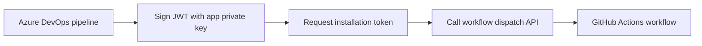

No personal access token, OAuth client secret, or interactive GitHub login is required.

## Configure GitHub App Integration

### Prerequisites

Ensure you have:

- A GitHub repository and permission to register and install a GitHub App.
- An Azure DevOps project where you can create pipelines and upload secure files.

### 1. Create and install the GitHub App

1. In GitHub, open your account or organization **Settings > Developer settings > GitHub Apps > New GitHub App**.
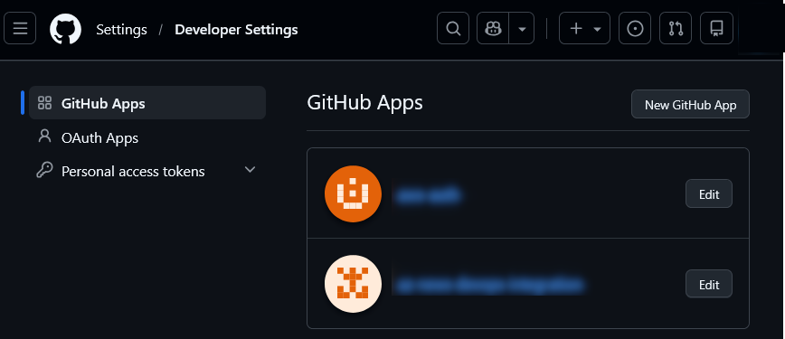
2. Enter an app name and a **Homepage URL** such as your organization URL (or any other URL by your choice).

   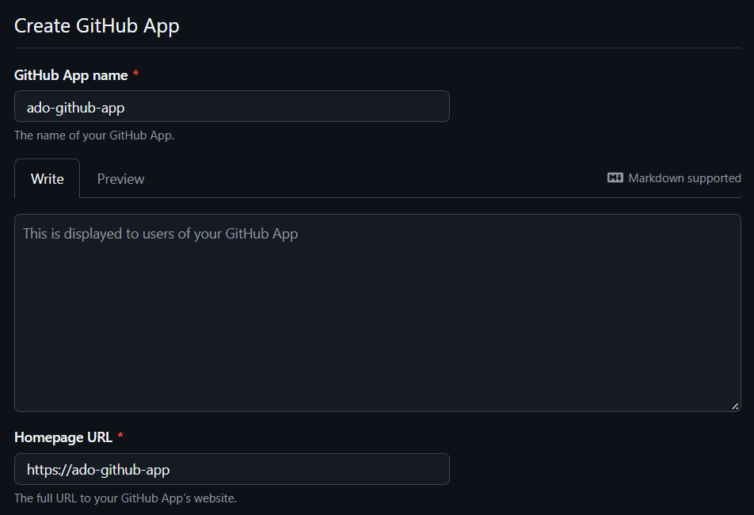

3. Leave OAuth/user authorization disabled and clear **Webhook > Active** option. 

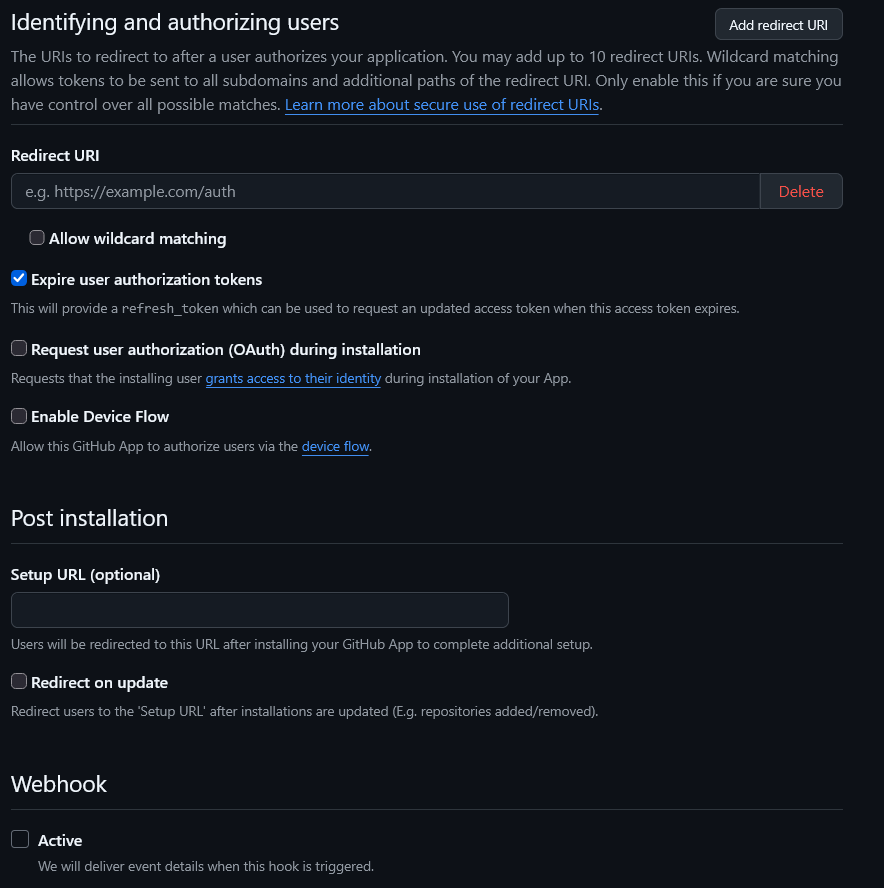

4. Set **Repository permissions > Actions** to **Read and write**. Leave unrelated permissions unchanged.

   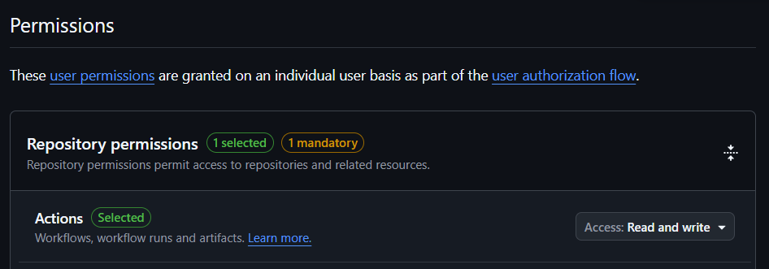

5. For this tutorial choose **Only on this account** and finish App creation. If you plan that someone else may need to install the app on other accounts, choose **Any account** instead.

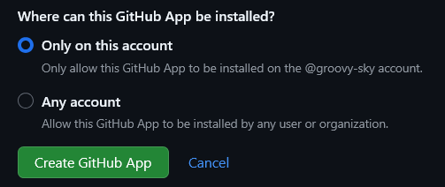

After installation, you will be redirected to the app's configuration page:

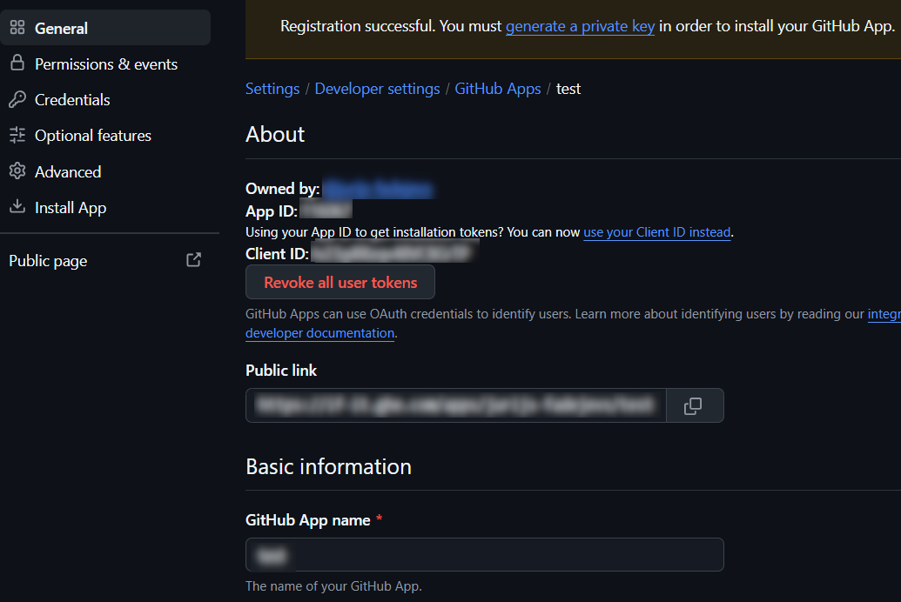

First you need to generate and download a private key for the GitHub App. Go to **Credentials > Key pairs > New key**, or **Private keys > Generate a private key** in older interfaces.

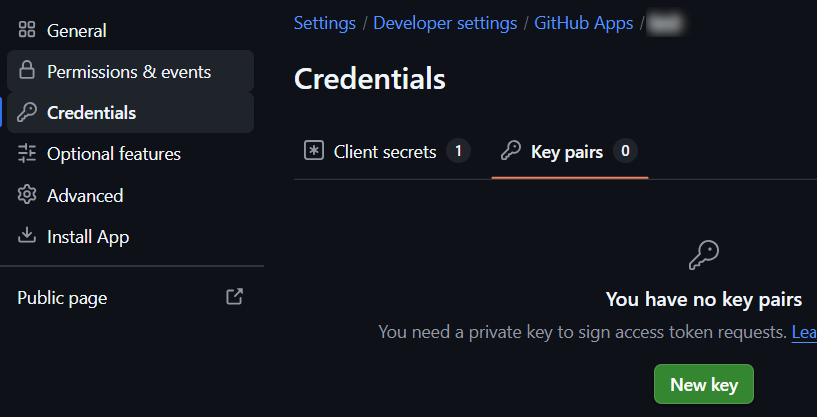

Store the downloaded PEM file locally. Later it will be used in the Azure DevOps pipeline to authenticate the GitHub App.

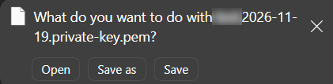

Next you'll need to grant permissions to the Github App itself. Go to **Install App** and choose the right account that owns the repository. Select your target repository and confirm installation.

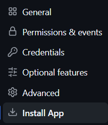

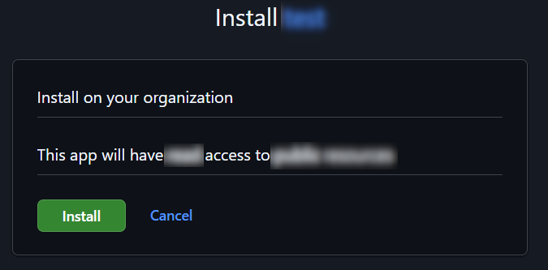

If all steps are completed successfully, your GitHub App should now have the necessary permissions and be installed on the target repository:

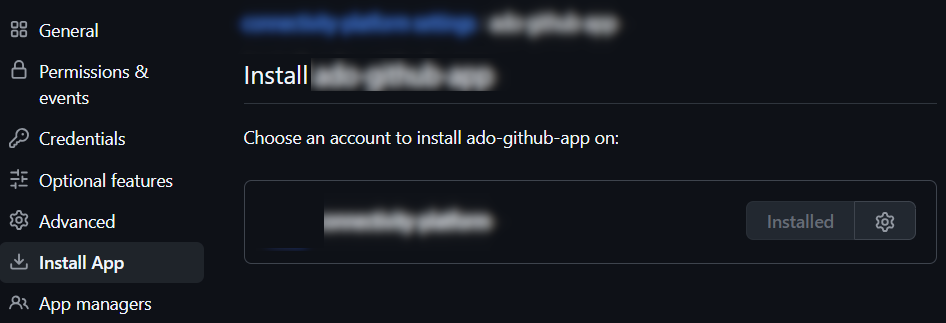

After installation, you you need to obtain installation ID. To do so copy the URL of gear icon for the installed app and look for `/installations/` in the URL. The number following it is the installation ID.

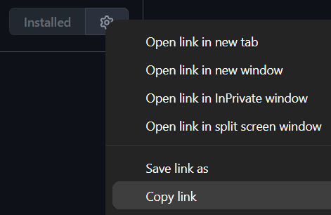


### 2. Create a test workflow

Create `.github/workflows/repo-info.yml` in your target GitHub repository:

```yaml
name: Repository information

on:
  workflow_dispatch:

permissions:
  contents: read

jobs:
  repo-info:
    runs-on: ubuntu-latest
    steps:
      - name: Show repository and ref
        env:
          REPOSITORY: ${{ github.repository }}
          REF: ${{ github.ref }}
        run: |
          printf 'Repository: %s\nRef: %s\n' "$REPOSITORY" "$REF"
```

This workflows returns the repository name and the reference (branch or tag) for which it is triggered.

#### GitHub endpoints

Different GitHub deployments use different endpoints. Set `GH_HOST` and
`GITHUB_API_URL` in the Azure DevOps pipeline's `env:` block below to match your
deployment, and register/install the app on that same GitHub host:

| Deployment | `GH_HOST` | `GITHUB_API_URL` |
| --- | --- | --- |
| GitHub.com | `github.com` | `https://api.github.com` |
| Enterprise Cloud with a dedicated subdomain | `SUBDOMAIN.ghe.com` | `https://api.SUBDOMAIN.ghe.com` |
| Enterprise Server | `github.example.com` | `https://github.example.com/api/v3` |

Use an agent and GitHub runner with the required network access and available runner labels.

### 3. Store the private key in Azure DevOps

In previous steps, you downloaded the GitHub App private key (PEM file). Now you'll store it securely in Azure DevOps so it can be used in the pipeline.

To do that:
1. Open your Azure DevOps project.
2. Select **Pipelines > Library > Secure files > + Secure file**.

   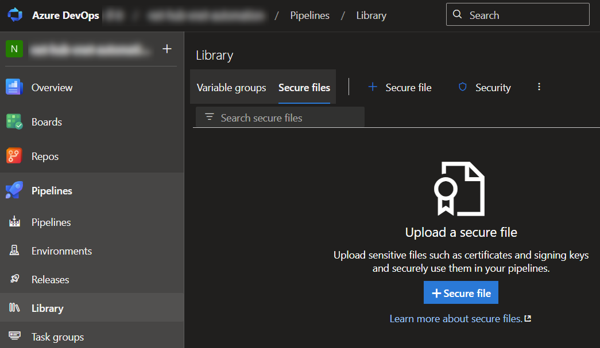

3. Upload the downloaded PEM under "Secure files":

   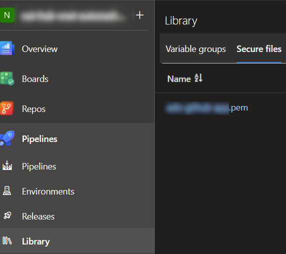


### 4. Add the Azure DevOps pipeline

Create `azure-pipelines.yml` in the repository used by Azure DevOps. Copy the complete example below, replacing these three values in its `env:` block:

| Placeholder | Replace with |
| --- | --- |
| `YOUR_APP_ID` | Numeric App ID from step 1 |
| `YOUR_INSTALLATION_ID` | Installation ID from step 1 |
| `OWNER/REPOSITORY` | Target GitHub repository, such as `example-org/example-repo` |

This example uses a Microsoft-hosted Ubuntu build agent with all required dependencies (`gh`, `jq`, `openssl`, and `curl`) preinstalled.

```yaml
trigger: none
pr: none

parameters:
  - name: workflowFile
    displayName: GitHub workflow file
    type: string
    default: repo-info.yml
  - name: targetRef
    displayName: GitHub branch or tag
    type: string
    default: main
  - name: workflowInputs
    displayName: GitHub workflow inputs (JSON object)
    type: string
    default: '{}'

pool:
  vmImage: ubuntu-latest

steps:
  - checkout: none

  - task: DownloadSecureFile@1
    name: githubAppKey
    displayName: Download GitHub App private key
    inputs:
      secureFile: \<github-app>\.pem

  - task: Bash@3
    displayName: Trigger GitHub Actions
    inputs:
      targetType: inline
      script: |
        set +x
        set -euo pipefail
        unset GH_DEBUG DEBUG

        for cmd in gh jq openssl curl; do
          command -v "$cmd" >/dev/null || {
            echo "Required tool missing: $cmd" >&2
            exit 1
          }
        done

        trap 'unset GH_TOKEN GH_ENTERPRISE_TOKEN JWT response' EXIT
        if [[ ! -r "$GITHUB_APP_PRIVATE_KEY_FILE" || ! -s "$GITHUB_APP_PRIVATE_KEY_FILE" ]]; then
          echo "The GitHub App private key file is missing, empty, or unreadable." >&2
          exit 1
        fi
        if ! openssl pkey -in "$GITHUB_APP_PRIVATE_KEY_FILE" -passin pass: -noout -check >/dev/null; then
          echo "A valid, unencrypted GitHub App PEM private key is required." >&2
          exit 1
        fi

        payload=$(jq -cen --arg ref "$TARGET_REF" --argjson inputs "$WORKFLOW_INPUTS" '
          if ($inputs | type) == "object" then {ref: $ref, inputs: $inputs}
          else error("Workflow inputs must be a JSON object")
          end
        ')

        base64url() {
          openssl base64 -A | tr '+/' '-_' | tr -d '='
        }
        now=$(date +%s)
        header=$(printf '%s' '{"alg":"RS256","typ":"JWT"}' | base64url)
        claims=$(jq -cn --arg iss "$APP_ID" \
          --argjson iat "$((now - 60))" --argjson exp "$((now + 540))" \
          '{iat: $iat, exp: $exp, iss: $iss}' | base64url)
        unsigned="${header}.${claims}"
        signature=$(printf '%s' "$unsigned" |
          openssl dgst -sha256 -sign "$GITHUB_APP_PRIVATE_KEY_FILE" -passin pass: |
          base64url)
        JWT="${unsigned}.${signature}"

        response=$(
          printf 'header = "Authorization: Bearer %s"\n' "$JWT" |
            curl --config - --silent --show-error --fail \
              --connect-timeout 10 --max-time 60 \
              --header 'Accept: application/vnd.github+json' \
              --header 'Content-Type: application/json' \
              --request POST --data '{}' \
              "${GITHUB_API_URL}/app/installations/${INSTALLATION_ID}/access_tokens"
        )
        GH_TOKEN=$(printf '%s' "$response" |
          jq -er '.token | if type == "string" and length > 0 then .
            else error("GitHub did not return an installation token") end')
        export GH_TOKEN
        export GH_ENTERPRISE_TOKEN="$GH_TOKEN"
        unset JWT response

        printf '%s' "$payload" | gh api --hostname "$GH_HOST" --method POST --silent \
          "repos/${TARGET_REPOSITORY}/actions/workflows/${WORKFLOW_FILE}/dispatches" \
          --input -

        echo "GitHub accepted the workflow dispatch request."
    env:
      GITHUB_APP_PRIVATE_KEY_FILE: $(githubAppKey.secureFilePath)
      APP_ID: 'YOUR_APP_ID'
      INSTALLATION_ID: 'YOUR_INSTALLATION_ID'
      GITHUB_API_URL: https://api.github.com
      GH_HOST: github.com
      GH_PROMPT_DISABLED: '1'
      TARGET_REPOSITORY: OWNER/REPOSITORY
      WORKFLOW_FILE: ${{ parameters.workflowFile }}
      TARGET_REF: ${{ parameters.targetRef }}
      WORKFLOW_INPUTS: ${{ parameters.workflowInputs }}
```


### 5. Run and verify

After PEM  is uploaded and yml is committed, you can need to: 

1. Add the pipeline in Azure DevOps. Go to **Pipelines > New pipeline**, choose its source repository, select `azure-pipelines.yml` and save it.

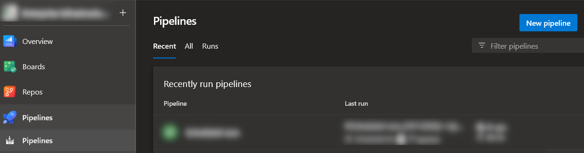

2. Open **Pipelines > Library > Secure files > \<github-app>\.pem > Pipeline permissions** and authorize this pipeline only.

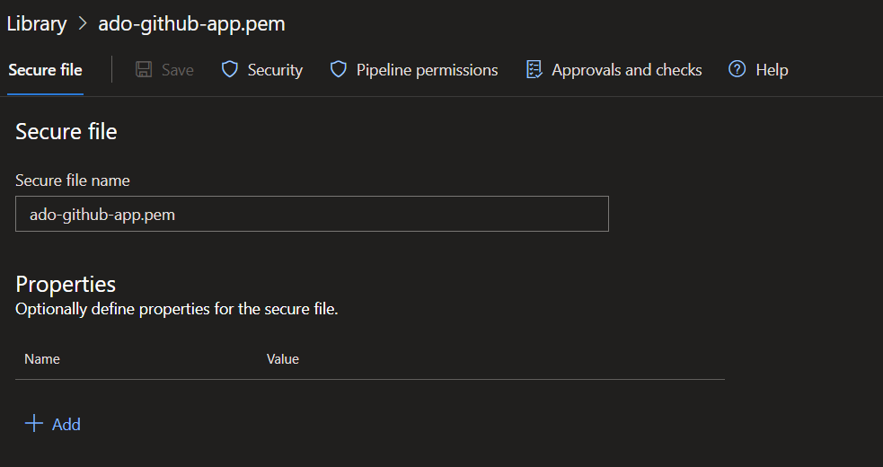

3. Select **Run pipeline** and use:
   - **GitHub workflow file:** `repo-info.yml` (filename, not display name).
   - **GitHub branch or tag:** `main`, or the branch/tag containing your workflow. The workflow must also exist on the default branch.
   - **GitHub workflow inputs:** `{}` for this example.

## Result

Check the pipeline logs for `GitHub accepted the workflow dispatch request.`

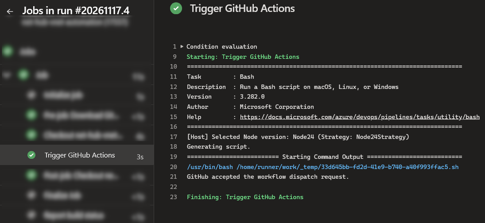

Open the GitHub repository's **Actions** tab and verify that the workflow ran on the expected ref and completed successfully:

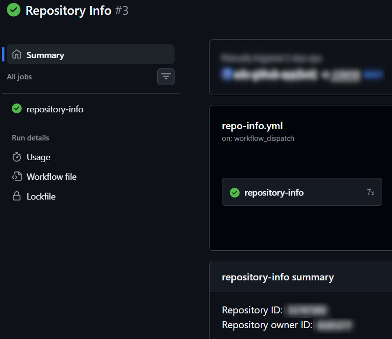
Azure DevOps only triggers the workflow; check its status and result in **GitHub Actions**. Retrying an accepted request can start another run.

The GitHub App can be used from any environment that meets the software and network requirements and securely accesses its private key.

## Summary

This part showed how to trigger GitHub Actions from Azure DevOps using a GitHub App, without a personal access token.

The series covered Azure DevOps and GitHub platform concepts, translating pipelines, and migrating Git repositories. It also showed how to connect GitHub Actions to Azure and trigger workflows from Azure DevOps, helping both platforms work together during a staged migration.

**End of series.** Return to [Part 1: Platform Concepts and Series Overview](../devops-to-github-00/README.md).
